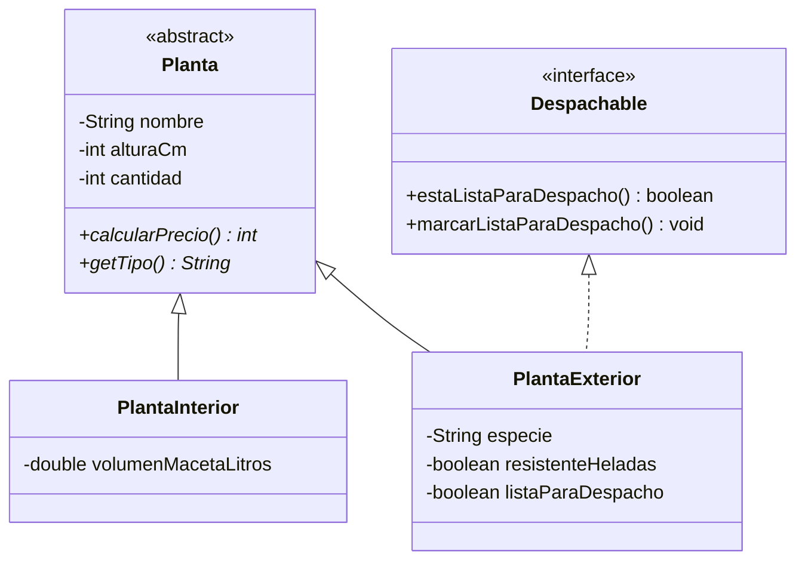

# Enunciado evaluación parcial 2 (simulacro)

| Sigla | Asignatura | Experiencia de Aprendizaje |
|---|---|---|
| DSY1102 | Programación Orientada a Objetos | EA2: Desarrollo de Interfaces Gráficas con Persistencia en Archivo |

| Tiempo | Modalidad de Trabajo | Indicadores de logro |
|---|---|---|
| 3 bloques | Individual | IL 2.1 al IL 2.8 |

## Condiciones de la evaluación

**Del entorno y la entrega**

- La evaluación es de carácter individual. No está permitida ninguna forma de colaboración entre estudiantes.
- No se permite el acceso a internet ni el uso de teléfonos, relojes inteligentes ni ningún otro dispositivo externo.
- El programa debe compilar y ejecutarse correctamente. Una solución que no compile no permite evidenciar ningún indicador de logro.
- El proyecto debe entregarse comprimido en formato ZIP, con tu nombre completo como nombre del archivo, antes de que finalice la sesión.

**De tu solución**

- El código debe organizarse en clases separadas, respetando las convenciones de nomenclatura de Java: PascalCase para nombres de clase, camelCase para métodos y atributos.
- Puedes crear métodos o clases auxiliares siempre que no contradigan los requerimientos del caso.
- No se admite el uso de herramientas de inteligencia artificial ni de recursos digitales externos.

---

## 1. Contexto del caso

El Vivero Hojas del Sur ya cuenta con el modelo de clases desarrollado en la evaluación anterior: el sistema distingue plantas de interior y de exterior, calcula el precio unitario de cada planta según su tipo y permite marcar las plantas de exterior como listas para despacho. Sin embargo, ese sistema solo funciona por consola y la información se pierde cada vez que el programa se cierra.

La administración del vivero ha solicitado transformarlo en una aplicación de escritorio con ventanas, que permita al personal de ventas registrar y eliminar plantas, y que conserve la información en archivos para que esté disponible la próxima vez que se abra la aplicación.

### Proyecto base

Al inicio de la evaluación, el/la docente te entregará un proyecto Maven con la configuración inicial, la clase de arranque y el modelo ya implementado y probado, correspondiente al diagrama siguiente. Tu trabajo consiste en construir sobre ese modelo la interfaz gráfica y el almacenamiento en archivos. No debes reescribir ni reemplazar las clases entregadas.

El modelo entregado ya aplica las siguientes reglas:

- Planta de interior: precio unitario base de $8.000. Si el volumen de la maceta supera los 5 litros, el precio se incrementa en un 25%.
- Planta de exterior: precio unitario base de $5.500. Si resiste las heladas, el precio se incrementa en un 20%.

Datos comunes: el nombre no puede ser nulo ni vacío, la altura debe estar entre 1 y 300 cm y la cantidad en stock debe estar entre 1 y 500 unidades. Si un dato no cumple, el modelo lo rechaza con un mensaje que explica el motivo.

## 2. Estructura del proyecto

La solución debe separar responsabilidades según el patrón Modelo-Vista-Controlador, con una capa de acceso a datos basada en el patrón DAO/Repository. El proyecto debe contener, como mínimo:

- Configuración del proyecto: el proyecto base ya incluye las dependencias de JavaFX y la clase de arranque de la aplicación. Debes agregar al archivo `pom.xml` la dependencia de la librería Gson disponible en el laboratorio, necesaria para trabajar con archivos JSON.
- Distribución de paquetes y responsabilidades acorde al patrón de diseño.

## 3. Ventana de la aplicación

Al ejecutar la aplicación se abre una única ventana, desde la cual se realizan todas las acciones. La ventana debe contener:

- Un formulario de registro con los campos descritos más abajo y un botón Registrar.
- Una tabla con las plantas registradas y las columnas Tipo, Nombre, Altura (cm), Cantidad y Precio unitario. El precio que se muestra es el que calcula el modelo para cada planta.
- Un botón Eliminar, que quita del registro la planta seleccionada en la tabla. Si no hay una fila seleccionada, la aplicación informa que se debe seleccionar una planta y no realiza ningún cambio.
- Un área de mensajes dentro de la misma ventana, donde se informa el resultado de cada acción: registro exitoso, dato no válido, eliminación, falta de selección o error al leer o guardar los archivos. Cada mensaje reemplaza al anterior. Los mensajes no se muestran por consola.

**Campos del formulario**

- Un selector de tipo con las opciones Interior y Exterior.
- Datos comunes: nombre, altura y cantidad.
- Dato de la planta de interior: volumen de la maceta en litros.
- Datos de la planta de exterior: especie, si resiste las heladas (sí/no) y si está lista para despacho (sí/no).

Al cambiar el tipo en el selector, solo quedan habilitados los datos específicos del tipo elegido; los datos del otro tipo quedan deshabilitados y no se consideran al registrar.

Al presionar Registrar, la aplicación valida los datos según la sección 4. Si son correctos, registra la planta, la tabla la muestra de inmediato, el área de mensajes informa la confirmación (por ejemplo: “Menta (Interior) registrada correctamente.”) y el formulario queda vacío para un nuevo registro.

## 4. Validaciones del formulario

Antes de registrar, el formulario debe verificar los datos ingresados según las siguientes reglas:

- Tipo: debe estar seleccionado.
- Nombre: no puede estar vacío ni contener solo espacios.
- Altura: número entero entre 1 y 300.
- Cantidad: número entero entre 1 y 500.
- Volumen de la maceta (solo interior): número mayor que cero; acepta decimales.
- Especie (solo exterior): no puede estar vacía ni contener solo espacios.

Las reglas de nombre, altura y cantidad son las mismas que ya aplica el modelo entregado. Si algún dato no es válido:

- la planta no se registra;
- el área de mensajes indica qué campo es incorrecto y por qué;
- los valores ya ingresados se mantienen para que puedan corregirse;
- la aplicación no se detiene ni muestra errores por consola.

## 5. Almacenamiento de la información

La información de las plantas debe conservarse entre una ejecución y otra, en formato JSON, en la carpeta raíz del proyecto:

- `interiores.json`: contiene las plantas de interior registradas.
- `exteriores.json`: contiene las plantas de exterior registradas.

El comportamiento esperado es el siguiente:

- Al iniciar, la aplicación carga automáticamente la información de ambos archivos y la muestra en la tabla.
- Si los archivos no existen (por ejemplo, la primera vez que se ejecuta), la aplicación inicia con la tabla vacía y sin mostrar errores.
- Cada vez que se registra o se elimina una planta, los archivos se actualizan automáticamente, sin que el usuario deba presionar un botón para guardar.
- Lo que muestra la tabla y lo guardado en los archivos debe coincidir en todo momento.

## 6. Datos de prueba y resultado esperado

Registra desde la aplicación las siguientes plantas:

| Tipo | Nombre | Altura (cm) | Cantidad | Datos específicos | Precio unitario |
|---|---|---|---|---|---|
| Interior | Menta | 20 | 15 | Maceta: 0,8 L | $8.000 |
| Interior | Helecho | 40 | 12 | Maceta: 6,5 L | $10.000 |
| Exterior | Menta | 35 | 20 | Especie: Mentha spicata \| Heladas: sí \| Despacho: sí | $6.600 |
| Exterior | Rosal | 90 | 8 | Especie: Rosa x hybrida \| Heladas: no \| Despacho: no | $5.500 |

Luego de registrarlas, la ventana debe mostrar las cuatro plantas con sus precios. Si se presiona Eliminar sin seleccionar una fila, el aviso aparece en la misma ventana.

Si un dato del formulario no es válido (por ejemplo, una altura `abc` o una cantidad `0`), el área de mensajes indica el campo con problemas y se mantienen los valores ingresados.

**Verificación de almacenamiento**

- Cierra la aplicación y vuelve a abrirla: la tabla debe mostrar las mismas cuatro plantas, y la Menta de exterior debe seguir lista para despacho.
- Elimina a Rosal, cierra la aplicación y vuelve a abrirla: Rosal ya no debe aparecer.
